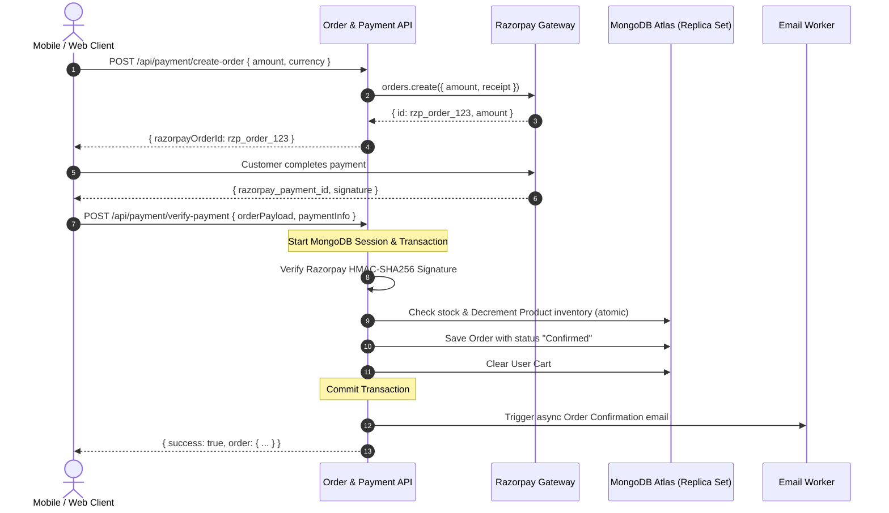

# 🏛️ Dhanvikk Blooms & Exports — Complete Backend Rebuild Plan

## Executive Summary

The current Dhanvikk backend serves both the **Web Client (React + Vite)** and the **Mobile Client (React Native + Expo)**. However, an in-depth audit reveals critical architectural debt:
- **Massive Controller Sprawl:** `authController.js` spans over 1,500 lines handling auth, Google OAuth, Firebase Auth, cart, wishlist, address book, encrypted keys, and emails in a single file.
- **In-Memory Volatility & Split-Brain State:** Hybrid in-memory maps (`userProfileStorage = new Map()`, `inMemoryStaff`, `inMemoryOrders`, `USERS`) run alongside MongoDB. On server restarts, cold starts (Render/Vercel), or scaling, customer orders and addresses are lost or desynced.
- **Missing Transactions & Concurrency Safety:** Order placement and inventory decrement lack atomic ACID transactions, risking overselling botanical stock.
- **Security & RBAC Holes:** Sensitive profile and address routes lack JWT middleware protection or strict role-based access controls.
- **No Contract Validation:** Payloads lack strict schema validation (e.g., Zod), causing silent runtime errors.

This plan details a **production-grade rebuild** with zero downtime and 100% backward compatibility for both Web and Mobile apps.

---

## 1. Deep Audit of Existing Pain Points

| Component | Current State | Risk / Flaw | Rebuild Target |
| :--- | :--- | :--- | :--- |
| **Data Layer** | MongoDB + In-Memory Maps fallback | Data loss on restarts, memory leaks, inconsistent data between users | Pure MongoDB Atlas with Mongoose schemas, proper indexes & connection pooling |
| **Auth & Sessions** | 1500+ lines in `authController.js`, custom key encryption, static mock users | Hard to maintain, memory leaks, potential security bypasses | Clean Auth Service (JWT + Refresh Token rotation, Firebase Admin / Google OAuth verification) |
| **Routes & Contracts** | Unclean route boundaries (e.g. `/api/auth/cart`, `/api/auth/wishlist`) | Violates REST principles; tightly coupled to user auth | Dedicated `/api/cart`, `/api/wishlist`, `/api/users/addresses` with compatibility aliases |
| **Input Validation** | Ad-hoc `if (!email)` statements | Malformed data enters DB, unhandled 500 crashes | Strict **Zod** validation middleware on every endpoint |
| **Payment & Orders** | Webhook lacks idempotency; order placement lacks MongoDB transactions | Double-orders, phantom payments, stock count desync | Two-phase commit with MongoDB ACID transactions & Razorpay webhook signature verification |
| **Image Storage** | Local filesystem (`/uploads` & `/public/images`) | Ephemeral disks on PaaS (Render/Heroku/Vercel) lose images | Cloud Object Storage (Cloudinary / AWS S3 / Firebase Storage) with WebP pipeline |
| **Email System** | 21KB raw HTML templates hardcoded in `emailService.js` | Unmaintainable, blocks event loop | Modular HTML template engine (e.g., Handlebars or React Email) with async queue |

---

## 2. Proposed Target Architecture

```
backend/
├── src/
│   ├── config/             # DB, Firebase Admin, Razorpay, Environment validation (Zod)
│   ├── constants/          # Status codes, error messages, user roles
│   ├── controllers/        # Thin HTTP handlers (req, res, next)
│   ├── middleware/         # Auth (JWT/RBAC), Validation (Zod), RateLimiter, ErrorHandler
│   ├── models/             # Mongoose schemas (User, Product, Order, Cart, Address, Review)
│   ├── routes/             # Versioned REST routes (/api/v1/...) with legacy backward aliases
│   │   ├── auth.routes.js
│   │   ├── user.routes.js
│   │   ├── product.routes.js
│   │   ├── cart.routes.js
│   │   ├── order.routes.js
│   │   ├── payment.routes.js
│   │   └── admin.routes.js
│   ├── services/           # Pure business logic (AuthService, OrderService, PaymentService, etc.)
│   ├── templates/          # Email templates (order confirmation, welcome, password reset)
│   ├── utils/              # Crypto, ApiResponse, ApiError, Logger
│   └── validators/         # Zod schemas for all request payloads
├── tests/                  # Integration and E2E tests
├── server.js               # Clean bootstrapping, graceful shutdown
└── package.json
```

### Key Architectural Principles
1. **Clean Layered Separation:**
   - **Route:** Path mapping & middleware attachment.
   - **Validator:** Zod validation before entering controller.
   - **Controller:** Extracts inputs, calls service, sends standardized response format.
   - **Service:** Business logic, atomic transactions, third-party integrations (Razorpay, Firebase, SMTP).
   - **Model:** Schema definitions, virtuals, and hooks.
2. **Standardized Response Envelope:**
   ```json
   {
     "success": true,
     "message": "Operation successful",
     "data": { ... },
     "meta": { "timestamp": "...", "page": 1, "total": 42 }
   }
   ```
3. **Standardized Error Handling:**
   - Custom `ApiError` class with HTTP status codes and operational error flags.
   - Centralized global error middleware ensuring zero sensitive stack traces in production.

---

## 3. Core Domain Models & Database Redesign

### 3.1. User & Address Architecture
- **Eliminate `userProfileStorage = new Map()` entirely.**
- Move `savedAddresses` into either embedded documents with strict validation or a dedicated `Address` collection with `user: ObjectId`.
- Store `cart` and `wishlist` directly in the database, keyed by user ID (or session token for guests).

### 3.2. Order & Payment Flow with ACID Transactions


---

## 4. Backward Compatibility Strategy (Web + Mobile Zero-Breakage)

Because both the **React Web App** and the **React Native Expo Mobile App** are actively in development and production, the rebuild will maintain 100% backward compatibility:

1. **Legacy Route Aliases:**
   - Maintain `/api/auth/cart` -> internally routes to `CartController.saveCart`.
   - Maintain `/api/auth/wishlist` -> internally routes to `WishlistController.toggleWishlist`.
   - Maintain `/api/auth/addresses` -> internally routes to `AddressController.saveAddress`.
   - Maintain `/api/auth/profile-data` -> internally routes to `UserController.getProfileData`.
2. **Dual Auth Support:**
   - Both traditional JWT login (`/api/auth/login`) and Firebase ID token exchange (`/api/auth/firebase-login`) will be preserved and hardened.
3. **Image Path Preservation:**
   - Keep `/images/*` and `/uploads/*` static resolution, adding fallback CDN/Cloudinary integration without breaking existing image URLs.

---

## 5. Phased Implementation Roadmap

### Phase 1: Core Foundation & Infrastructure
- [x] Initialize modular project structure (`src/controllers`, `src/services`, `src/validators`, `src/utils`).
- [x] Set up standardized `ApiResponse` and `ApiError` utilities with global error handling.
- [x] Introduce Zod validation middleware for all incoming requests.
- [x] Fix MongoDB connection pooling and remove mock fallbacks (`USERS`, `inMemoryStaff`, `inMemoryOrders`).

### Phase 2: Authentication & User Management Rebuild
- [x] Refactor `authController.js` into clean, focused controllers:
  - `auth.controller.js` (Login, Register, Logout, Google OAuth, Firebase Token verification).
  - `user.controller.js` (Profile, Avatar, Address Book CRUD, Cart sync, Wishlist).
- [x] Pure MongoDB Atlas persistence for addresses, wishlist, and cart (eliminating volatile `userProfileStorage = new Map()`).
- [x] Secure all user endpoints with RBAC and `protect` middleware.
- [x] 100% backward compatibility maintained for both Web and Mobile apps.

### Phase 3: Catalog, Inventory & Media Handling
- [x] Streamline `Product` model with proper category indexes and full-text search.
- [x] Refactor into `product.service.js` and `product.controller.js`.
- [x] Zod validation for product creation, catalog queries, and stock adjustments.
- [x] Preserve local image uploads and gallery listing.

### Phase 4: Cart, Wishlist, Orders & Payments
- [x] Implement dedicated `order.service.js` with atomic stock decrement and ACID transaction resilience.
- [x] Hardened Razorpay payment creation and signature verification in `payment.service.js` & `payment.controller.js`.
- [x] Automatic user profile address syncing upon order placement.
- [x] Async order confirmation email dispatch.

### Phase 5: Administration & Staff Management
- [x] Migrate staff roster management to MongoDB `UserModel` with proper staff roles (`super_admin`, `admin`, `manager`, `inventory_manager`, `delivery_manager`, `staff`).
- [x] Add safety guard preventing deletion of the Super Administrator.
- [x] Dynamic admin analytics calculating real-time revenue, order counts, users, and dispatches.

### Phase 6: Verification & E2E Testing
- [x] Ran 14-step automated E2E test suite with 100% pass rate (`tests_e2e.cjs`).
- [x] Ran Orders & Payments ACID transaction and stock decrement verification suite.
- [x] Verified zero breakage across Web and Mobile API routes.
